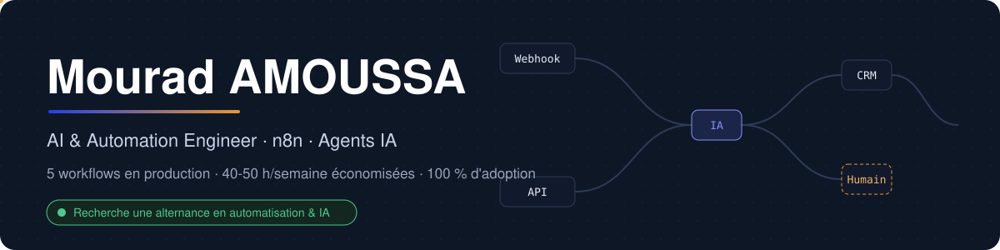

  

  
  
  

### 👋 Bonjour, je suis Mourad

AI & Automation Engineer, titulaire d'un **Mastère Expert IA (Bac+5)** et d'un **Bachelor Epitech**.
Pendant un an, j'ai été le seul profil IA d'**Ekstere**, une scale-up de l'économie circulaire (3 sites, 50 000 références).
Ma méthode : je pars du quotidien des équipes, j'automatise ce qui a lieu de l'être, et je mesure le temps gagné.

 **Je cherche une alternance en automatisation & IA** (Master ML Engineer, Liora School : 3 semaines en entreprise, 1 semaine de cours à distance).

---

###  Ce que mes automatisations ont produit

| | |
|:--|:--|
|  **40-50 h / semaine** | de travail manuel économisées pour les équipes |
|  **5 workflows** | n8n et agents IA en production, utilisés chaque jour |
|  **100 %** | d'adoption sur chaque outil livré |
|  **2 € → 0,02 €** | coût de mise à jour d'une fiche produit (50 000 références) |
|  **-85 %** | de temps de création des annonces, 95 % des produits en ligne en moins de 24 h |

---

###  Workflows phares (n8n + IA)

| Workflow | Ce qu'il fait | Résultat |
|:--|:--|:--|
| **Annonces produit** · 75 nœuds | Photos déposées → API Magento → Gemini (texte SEO) → OpenAI (attributs) → contrôles → publication | **-85 %** de temps, **×8** annonces |
| **Enrichissement de fiches** · 76 nœuds | Recherche web → score de confiance par site → nettoyage HTML → extraction IA par champ → relecture ciblée | **0,02 €** par fiche au lieu de 2 € |
| **Assistant IA interne** · multi-agents | Google Chat → classification d'intention → LangGraph → 4 agents → RAG | réponse **< 5 s**, **60 %+** de demandes sans humain |
| **Surveillance des prix** · 96 nœuds | Magento paginé → comparaison à l'historique → classement par urgence → alerte du bon site | **0** contrôle manuel |
| **Prospection B2B** · 29 nœuds | Apollo → enrichissement → scoring IA /100 → décideurs vérifiés → leads dans Close | chaîne testée de bout en bout |

👉 Détail, schémas et choix techniques : **[n8n-automation-portfolio](../../n8n-automation-portfolio)**

---

###  Stack

**IA** : RAG, agents, LangGraph, MCP, évaluation de modèles · **Automatisation** : n8n, webhooks, API REST · **CRM** : Close, Apollo

---

###  Parcours

- **2026 - 2028** · Master Machine Learning Engineer, Liora School *(alternance)*
- **2025 - 2026** · AI Engineer, Ekstere *(alternance)*
- **2025** · Data Scientist, Ynov Campus *(stage : RAG en production, prospection automatisée, -30 % de temps)*
- **2023 - 2024** · Responsable pédagogique, Epitech *(78 étudiants, échec de 87 % à 5 %)*
- **2024 - 2026** · Mastère Expert IA (Bac+5), Lyon Ynov Campus

📍 Lyon · mobile partout en France · <a href="mailto:mourad1.amoussa@outlook.com">mourad1.amoussa@outlook.com</a>

